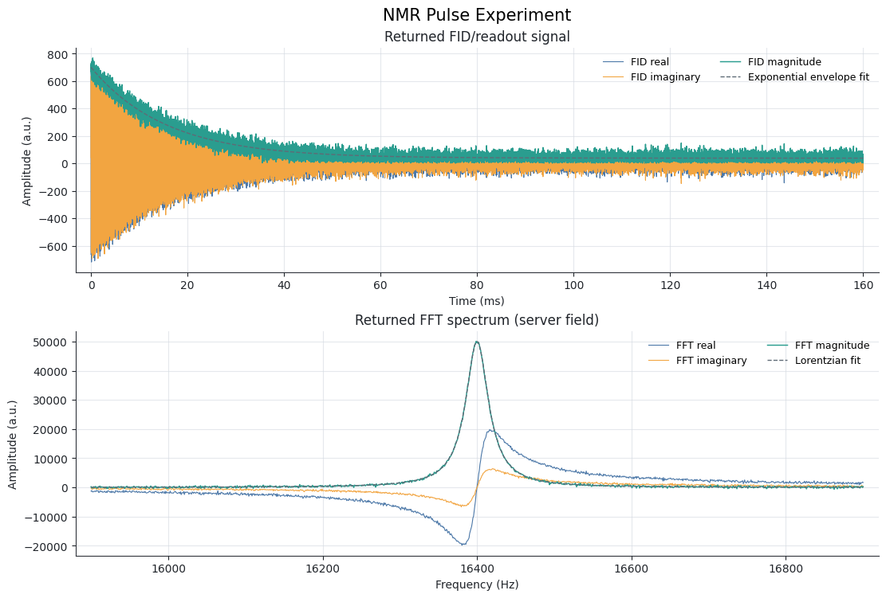
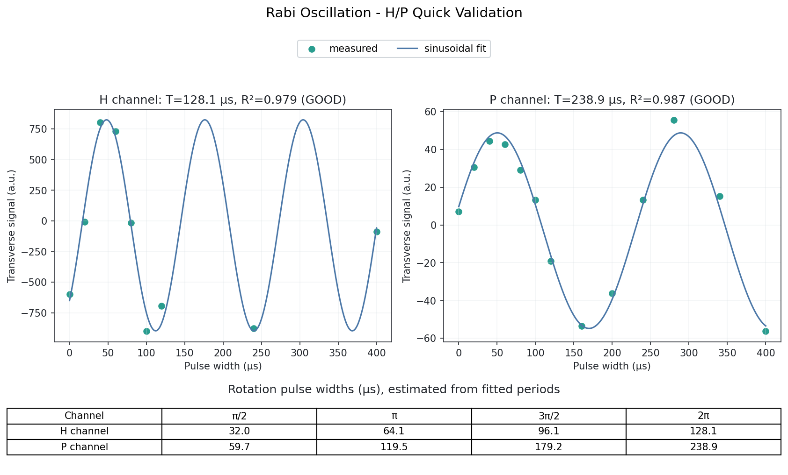
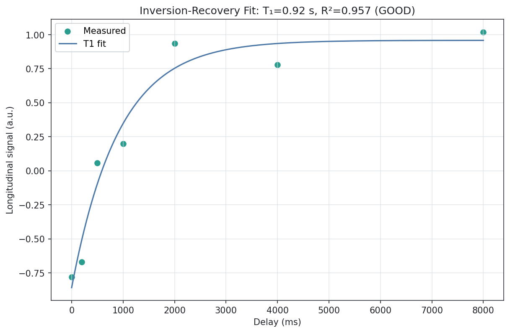
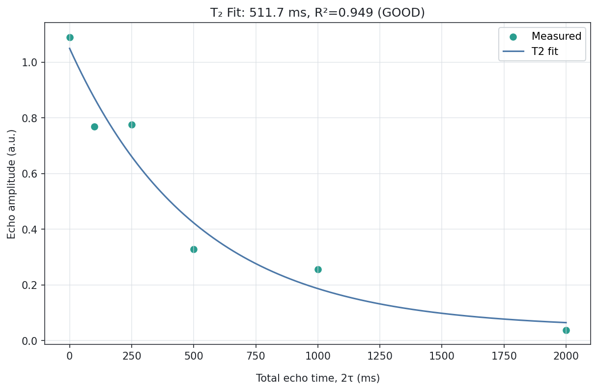

量子计算原理
============
本章介绍基础量子计算实验的调用方法、主要参数和返回结果。

.. note::

   教学说明使用公开 snake_case 参数，各实验页面从实际模型生成详细约束和参考值。图示用于教学说明，设备验证记录见验证指南。

.. toctree::
   :maxdepth: 1

   nmr_signal
   rabi
   qubit
   t1
   t2
   control
   initialization
   gates_circuit
   tomography
   computing_task
   rabi_scan
   relaxation_scan

NMR 现象与信号
~~~~~~~~~~~~~~~~~~

通过 NMR 脉冲实验观察自由感应衰减和频谱：

.. literalinclude:: ../../../../../examples/lab/two/principles/nmr_signal.py
   :language: python
   :linenos:

实验参数解析
^^^^^^^^^^^^

- **Pulse**: 脉冲参数，包括通道、宽度、振幅、相位和频率偏移，详情参阅 ``spinqnmrlink.Pulse``
- **freq_h**: 氢共振频率（MHz），取值范围 ``0 < freq_h < 100``
- **freq_p**: 磷共振频率（MHz），取值范围 ``0 < freq_p < 100``
- **make_pps**: 是否生成 PPS 信号
- **sample_path**: 采样路径：``0`` 为氢通道，``1`` 为磷通道
- **custom_freq**: 是否使用 ``freq_h`` 和 ``freq_p`` 指定的频率；为 ``False`` 时使用设备锁场频率

实验结果解析
^^^^^^^^^^^^

    自由感应衰减信号、频谱及主峰洛伦兹拟合

返回结果中 ``graph`` 字段的结构如下：

.. code-block:: text

    {
        "result": {
            "graph": [
                {
                    "<chart_name>": [[x, y], ...]
                },
                ...
            ]
        }
    }

- **graph**: 保存各实验步骤的图表数据。步骤内的键由服务端返回的 ``chart_name`` 决定，值为 ``[x, y]`` 点列表。SDK 绘图功能可识别以下曲线：

    - **fidRe**: 自由感应衰减（FID）信号的实部
    - **fidIm**: 自由感应衰减信号的虚部
    - **fidMod**: 自由感应衰减信号的模值
    - **lorenz**: 频谱主峰的洛伦兹拟合曲线
    - **fftRe**: 傅里叶变换（FFT）频谱的实部
    - **fftIm**: 傅里叶变换频谱的虚部
    - **fftMod**: 傅里叶变换频谱的模值
    - **fftFit**: 频谱拟合曲线

拉比振荡实验
~~~~~~~~~~~~

测量不同脉冲宽度下的拉比振荡，估计 π/2 和 π 脉冲宽度：

.. literalinclude:: ../../../../../examples/lab/two/principles/rabi_scan.py
   :language: python
   :linenos:

实验参数解析
^^^^^^^^^^^^

- **Pulse**: 脉冲参数，包括通道、宽度、振幅、相位和频率偏移，详情参阅 ``spinqnmrlink.Pulse``
- **freq_h**: 氢共振频率（MHz），取值范围 ``0 < freq_h < 100``
- **freq_p**: 磷共振频率（MHz），取值范围 ``0 < freq_p < 100``
- **make_pps**: 是否生成 PPS 信号
- **sample_path**: 采样路径：``0`` 为氢通道，``1`` 为磷通道
- **custom_freq**: 是否使用自定义频率

代码流程解析
^^^^^^^^^^^^

每次扫描选择一个通道并记录各脉宽对应的信号，channel=0 为氢，channel=1 为磷。每次调用单独拟合，实际脉宽仍需依据当前设备校准。图示用于解释拟合，不代表此版本的硬件验证。

实验结果解析
^^^^^^^^^^^^

   Rabi 振荡拟合和旋转脉宽

结果中常用的字段如下：

- **graph**: 当前脉宽对应的图表数据
- **width**: 脉冲宽度
- **real**: 信号强度实部值

量子比特实验
~~~~~~~~~~~~

观测量子比特的物理特性

.. literalinclude:: ../../../../../examples/lab/two/principles/qubit.py
   :language: python
   :linenos:

实验参数解析
^^^^^^^^^^^^

- **Pulse**: 脉冲参数，包括通道、宽度、振幅、相位和频率偏移，详情参阅 ``spinqnmrlink.Pulse``
- **sample_path**: 采样路径：``0`` 为氢通道，``1`` 为磷通道
- **pulses**: 脉冲序列

实验结果解析
^^^^^^^^^^^^

结果中常用的字段如下：

- **graph**: 实验各步骤返回的图表数据
- **coordinate**: 量子比特在布洛赫球上的坐标
- **matrix**: 量子态的密度矩阵，包含实部和虚部
- **probability**: 测量结果的概率分布

T1 纵向弛豫实验
~~~~~~~~~~~~~~~~~~

通过反转恢复序列测量纵向磁化的恢复过程

.. literalinclude:: ../../../../../examples/lab/two/principles/relaxation_scan.py
   :language: python
   :linenos:

实验参数解析
^^^^^^^^^^^^

- **Pulse**: 脉冲参数，包括通道、宽度、振幅、相位和频率偏移，详情参阅 ``spinqnmrlink.Pulse``
- **sample_path**: 采样路径：``0`` 为氢通道，``1`` 为磷通道
- **pulses**: 本示例使用反转脉冲和可变延迟；延迟宽度用于扫描纵向磁化的恢复过程

代码流程解析
^^^^^^^^^^^^

示例扫描多个延迟时间，读取各次实验返回的实部信号，并用反转恢复模型 ``M(t) = C - A exp(-t/T1)`` 拟合。图中同时显示测量点、拟合曲线、T1 和拟合优度。T1 表示纵向磁化恢复的时间尺度。

实验结果解析
^^^^^^^^^^^^

   T1 反转恢复拟合

结果中常用的字段如下：

- **graph**: 各延迟时间对应的图表数据
- **width**: 延迟脉冲宽度
- **real**: 信号强度实部值
- **coordinate**: 量子比特在布洛赫球上的坐标
- **matrix**: 量子态的密度矩阵，包含实部和虚部
- **probability**: 测量结果的概率分布

T2 横向弛豫实验
~~~~~~~~~~~~~~~~~~
通过自旋回波序列测量横向磁化的衰减过程

.. literalinclude:: ../../../../../examples/lab/two/principles/relaxation_scan.py
   :language: python
   :linenos:

实验参数解析
^^^^^^^^^^^^

- **Pulse**: 脉冲参数，包括通道、宽度、振幅、相位和频率偏移，详情参阅 ``spinqnmrlink.Pulse``
- **sample_path**: 采样路径：``0`` 为氢通道，``1`` 为磷通道
- **pulses**: 本示例包含四个脉冲：

  - 第一个脉冲：π/2 脉冲，激发横向磁化
  - 第二个脉冲：第一段延迟
  - 第三个脉冲：π 脉冲，使自旋重新聚相
  - 第四个脉冲：第二段延迟，与第一段等长

代码流程解析
^^^^^^^^^^^^

示例改变两段等长延迟，扫描总回波时间，并读取各次实验返回的信号模值。回波幅值用带基线的指数模型 ``S(t) = A exp(-t/T2) + C`` 拟合；图的横轴为总回波时间 ``2τ``。T2 表示回波包络衰减的时间尺度。

实验结果解析
^^^^^^^^^^^^

   T2 自旋回波衰减拟合，横轴表示总回波时间 ``2τ``

结果中常用的字段如下：

- **graph**: 各总回波时间对应的图表数据
- **width**: 延迟脉冲宽度
- **mod**: 信号强度模值
- **coordinate**: 量子比特在布洛赫球上的坐标
- **matrix**: 量子态的密度矩阵，包含实部和虚部
- **probability**: 测量结果的概率分布

量子控制实验
~~~~~~~~~~~~

利用射频场调控量子比特状态

.. literalinclude:: ../../../../../examples/lab/two/principles/control.py
   :language: python
   :linenos:

实验参数解析
^^^^^^^^^^^^

- **Pulse**: 脉冲参数，包括通道、宽度、振幅、相位和频率偏移，详情参阅 ``spinqnmrlink.Pulse``
- **sample_path**: 采样路径：``-1`` 为所有通道，``0`` 为氢通道，``1`` 为磷通道
- **pulses**: 本示例包含两个脉冲：

  - 第一个脉冲：作用于氢通道（``path=0``）的 π/2 脉冲
  - 第二个脉冲：作用于磷通道（``path=1``）的 π/2 脉冲

实验结果解析
^^^^^^^^^^^^

结果中常用的字段如下：

- **graph**: 实验各步骤返回的图表数据
- **coordinate**: 量子比特在布洛赫球上的坐标
- **matrix**: 两个量子比特系统的密度矩阵，包含实部和虚部
- **probability**: 测量结果的概率分布

量子系统初始化实验
~~~~~~~~~~~~~~~~~~

实现量子系统的初始化过程

.. literalinclude:: ../../../../../examples/lab/two/principles/initialization.py
   :language: python
   :linenos:

实验参数解析
^^^^^^^^^^^^

- **Pulse**: 脉冲参数，包括通道、宽度、振幅、相位和频率偏移，详情参阅 ``spinqnmrlink.Pulse``
- **repeat**: 重复次数，取值不小于 ``0``，默认为 ``5``；本示例使用 ``9``
- **pulses**: 本示例包含 12 个脉冲：

  - 前6个脉冲：作用在氢通道(path=0)的脉冲序列，用于初始化氢核自旋
  - 后6个脉冲：作用在磷通道(path=1)的脉冲序列，用于初始化磷核自旋

实验结果解析
^^^^^^^^^^^^

结果中常用的字段如下：

- **graph**: 系统初始化各步骤返回的图表数据
- **Hlamda**: 氢核的 Lambda 参数
- **Plamda**: 磷核的 Lambda 参数
- **fidelity**: 服务端返回的初始化保真度
- **matrix**: 服务端返回的双比特密度矩阵
- **probability**: 按 ``|00⟩``、``|01⟩``、``|10⟩``、``|11⟩`` 排列的基态概率

量子逻辑门与量子线路
~~~~~~~~~~~~~~~~~~~~

构建基于控制操作的量子门与量子线路

.. literalinclude:: ../../../../../examples/lab/two/principles/gates_circuit.py
   :language: python
   :linenos:

实验参数解析
^^^^^^^^^^^^

- **Pulse**: 脉冲参数，包括通道、宽度、振幅、相位和频率偏移，详情参阅 ``spinqnmrlink.Pulse``
- **Gate**: 量子门参数，包括门类型和目标量子比特，详情参阅 ``spinqnmrlink.Gate``
- **Circuit**: 量子线路及其中的量子门，详情参阅 ``spinqnmrlink.Circuit``

- **sample_path**: 采样路径：``-1`` 为所有通道，``0`` 为氢通道，``1`` 为磷通道
- **using_pulse**: 是否使用脉冲序列。设为 ``True`` 时提交 ``pulses``；设为 ``False`` 时提交 ``circuit``
- **using_custom_gate**: 是否使用自定义量子门
- **using_custom_pps**: 是否使用自定义 PPS 初始化
- **pps_json**: 自定义 PPS 初始化所用的 JSON 字符串
- **pps_repeat**: 自定义 PPS 初始化的重复次数
- **Hlamda**: 氢核的 Lambda 参数，可使用量子系统初始化返回的数值
- **Plamda**: 磷核的 Lambda 参数，可使用量子系统初始化返回的数值

实验结果解析
^^^^^^^^^^^^

结果中常用的字段如下：

- **graph**: 实验各步骤返回的图表数据
- **matrix**: 量子态的密度矩阵，包含实部和虚部
- **probability**: 按 ``|00⟩``、``|01⟩``、``|10⟩``、``|11⟩`` 排列的基态概率

量子态重构
~~~~~~~~~~~~

对量子态进行观测与重构

.. literalinclude:: ../../../../../examples/lab/two/principles/tomography.py
   :language: python
   :linenos:

实验参数解析
^^^^^^^^^^^^

- **Gate**: 量子门参数，包括门类型和目标量子比特，详情参阅 ``spinqnmrlink.Gate``
- **Circuit**: 量子线路及其中的量子门，详情参阅 ``spinqnmrlink.Circuit``

- **sample_path**: 采样路径：``-1`` 为所有通道，``0`` 为氢通道，``1`` 为磷通道
- **using_custom_gate**: 是否使用自定义量子门
- **using_custom_pps**: 是否使用自定义 PPS 初始化
- **pps_json**: 自定义 PPS 初始化所用的 JSON 字符串
- **pps_repeat**: 自定义 PPS 初始化的重复次数
- **Hlamda**: 氢核的 Lambda 参数，可使用量子系统初始化返回的数值
- **Plamda**: 磷核的 Lambda 参数，可使用量子系统初始化返回的数值

实验结果解析
^^^^^^^^^^^^

结果中常用的字段如下：

- **graph**: 量子态层析各步骤返回的图表数据
- **q0_lamda**: 第一个量子比特的频谱拟合参数
- **q1_lamda**: 第二个量子比特的频谱拟合参数
- **q0_b**: 第一个量子比特的频谱拟合参数
- **q1_b**: 第二个量子比特的频谱拟合参数
- **matrix**: 重构的量子态密度矩阵，包含实部和虚部
- **probability**: 测量结果的概率分布
- **fidelity**: 结果中包含该字段时，表示服务端给出的态保真度
- **purity**: 量子态的纯度，表示量子态的混合程度
- **entropy**: 量子态的熵，表示量子态的混乱程度
- **raw**: 服务端返回的完整重构结果

量子计算任务
~~~~~~~~~~~~

进行真实量子计算任务

.. literalinclude:: ../../../../../examples/lab/two/principles/computing_task.py
   :language: python
   :linenos:

实验参数解析
^^^^^^^^^^^^

- **Gate**: 量子门参数，包括门类型和目标量子比特，详情参阅 ``spinqnmrlink.Gate``
- **Circuit**: 量子线路及其中的量子门，详情参阅 ``spinqnmrlink.Circuit``

- **sample_path**: 采样路径：``-1`` 为所有通道，``0`` 为氢通道，``1`` 为磷通道
- **using_custom_gate**: 是否使用自定义量子门
- **using_custom_pps**: 是否使用自定义 PPS 初始化
- **pps_json**: 自定义 PPS 初始化所用的 JSON 字符串
- **pps_repeat**: 自定义 PPS 初始化的重复次数
- **Hlamda**: 氢核的 Lambda 参数，可使用量子系统初始化返回的数值
- **Plamda**: 磷核的 Lambda 参数，可使用量子系统初始化返回的数值

实验结果解析
^^^^^^^^^^^^

结果中常用的字段如下：

- **graph**: 量子计算任务各步骤返回的图表数据
- **matrix**: 量子态的密度矩阵，包含实部和虚部
- **probability**: 测量结果的概率分布
- **fidelity**: 服务端返回的保真度
- **gateNums**: 量子门数量
- **hFre_offset**: 氢频率偏移
- **pFre_offset**: 磷频率偏移
- **pulseControlTime**: 脉冲控制时间
- **pureTime**: 赝纯态制备时间
- **purity**: 纯度
- **relaxtion**: 弛豫时间
- **sampleTime**: 采样时间
- **smt**: 系统综合测量次数
